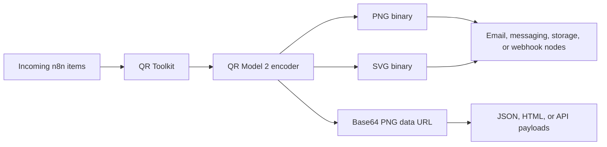

# n8n-nodes-qr-toolkit

Generate standards-compliant QR codes directly inside n8n. QR Toolkit accepts text or expression-driven content and returns a PNG, an SVG, or a Base64 PNG data URL without contacting an external service.

The QR encoder and renderers are implemented in TypeScript and ship with the node. No Python installation, system executable, canvas library, runtime dependency, API key, or external QR service is required.



## Features

- QR Model 2 versions 1-40 with automatic version and mask selection
- UTF-8 byte-mode encoding
- L, M, Q, and H error-correction levels
- PNG, SVG, and Base64 PNG data URL output
- Configurable dimensions, quiet-zone margin, and foreground/background colors
- Native n8n binary data, metadata, item linking, expressions, and `Continue On Fail` support
- Sequential item processing to keep peak memory use predictable
- Local execution with no network, credential, environment-variable, or file-system access
- No runtime dependencies

## Requirements

- n8n with community nodes enabled
- Node.js 22 or newer when installing or developing the package manually

Until the package is verified by n8n, use it only on a self-hosted n8n instance that permits unverified community nodes. Installation availability on n8n Cloud depends on n8n verification and is not guaranteed.

## Installation

### Self-hosted n8n user interface

1. Open **Settings > Community Nodes** in n8n.
2. Select **Install**.
3. Enter `n8n-nodes-qr-toolkit` as the npm package name.
4. Accept the community-node risk notice and complete the installation.
5. Search the node picker for **QR Toolkit**.

Restart n8n if the node does not appear immediately. Your n8n administrator must allow community packages for this option to be available.

### npm installation

Install the package in the custom nodes directory used by your self-hosted n8n instance, then restart n8n:

```bash
cd ~/.n8n/nodes
npm install n8n-nodes-qr-toolkit
```

For Docker deployments, make the installation part of the image or use the Community Nodes interface with a persistent n8n data volume. Do not install the package in an ephemeral container layer that disappears on restart.

This package is an n8n node plugin; it does not expose a separate JavaScript API for application code.

## Quick start

1. Add a **Manual Trigger** or another source node.
2. Add **QR Toolkit**.
3. Select **Generate QR Code**.
4. Set **Content** to text or an expression such as `{{ $json.url }}`.
5. Choose an output format and execute the workflow.

For a ready-to-import workflow, download [`examples/generate-qr-code.json`](examples/generate-qr-code.json), choose **Import from File** in n8n, and execute it. The example creates a PNG in the `data` binary property.

## Fields

| Field                  | Required | Default                        | Description                                                                                        |
| ---------------------- | -------- | ------------------------------ | -------------------------------------------------------------------------------------------------- |
| Content                | Yes      | -                              | Text to encode. Expressions resolve independently for each input item.                             |
| Output Format          | Yes      | PNG                            | Returns a PNG binary, SVG binary, or Base64 PNG data URL.                                          |
| Width                  | Yes      | `512`                          | Output width and height in pixels, from 64 to 4096.                                                |
| Margin                 | Yes      | `4`                            | Quiet-zone width in QR modules, from 0 to 64. Four modules is recommended for reliable scanning.   |
| Error Correction Level | Yes      | M                              | L, M, Q, or H. Higher levels recover from more damage but reduce capacity.                         |
| Dark Color             | Yes      | `#000000`                      | Foreground color in six-digit `#RRGGBB` format.                                                    |
| Light Color            | Yes      | `#FFFFFF`                      | Background color in six-digit `#RRGGBB` format.                                                    |
| Binary Property Name   | PNG/SVG  | `data`                         | n8n binary property that receives the generated file.                                              |
| File Name              | PNG/SVG  | `qr-code.png` or `qr-code.svg` | Output name. Unsafe path and control characters are removed and the correct extension is enforced. |

## Output

For PNG and SVG, QR Toolkit preserves the incoming JSON and binary properties, adds the generated file to the selected binary property, and appends:

- `qrContent`
- `qrFormat`
- `qrWidth`
- `qrFileName`
- `qrGeneratedAt` as an ISO 8601 timestamp

For **Base64 Data URL**, the node preserves the incoming JSON, adds only `dataUrl`, and does not create a binary property. The value starts with `data:image/png;base64,`.

Every output includes n8n item-linking information so expressions in downstream nodes continue to resolve against the correct source item.

## Limits and validation

- Content must not be empty and is limited to 10,000 JavaScript characters as a safety boundary.
- QR capacity is lower than 10,000 characters in many cases. Actual capacity depends on UTF-8 byte length, selected error correction, and the maximum QR Model 2 version. The node returns a specific capacity error when the content does not fit.
- Width must be an integer from 64 through 4096 pixels and must provide at least one pixel per rendered module, including the margin.
- Margin must be an integer from 0 through 64 modules.
- Colors must be opaque, six-digit hexadecimal values in `#RRGGBB` format. Short hex and alpha values are not supported.
- Binary property names must not be empty.
- File names are reduced to a safe base name, limited to 128 characters, and forced to the selected `.png` or `.svg` extension.
- Strong dark-on-light contrast and the default four-module margin provide the most reliable scans. Custom colors can make a valid QR code difficult to scan.

## Integration examples

The default binary property is `data`. Change it in QR Toolkit or in the downstream node when a workflow already uses that property name.

### Gmail

Generate PNG or SVG output. In **Gmail > Message > Send**, add an attachment and set **Attachment Field Name (in Input)** to `data`. The generated file name is passed through as the attachment name.

### Telegram

Generate PNG output, then use **Telegram > Message > Send Document** and choose n8n binary data as the source. Set the input binary field to `data`. Use **Send Photo** instead when Telegram should render the PNG inline and no document semantics are needed.

### Google Drive

Generate PNG or SVG output, then use **Google Drive > File > Upload**. Select binary input and set **Input Data Field Name** to `data`. The QR Toolkit file name can be reused by the upload node.

### S3

Generate PNG or SVG output, then use the **S3** upload operation. Select binary input and set the input binary field to `data`. Use `{{ $json.qrFileName }}` as the object key when the S3-compatible node expects a JSON expression for the destination name.

### Respond to Webhook

Use PNG or SVG output when the webhook must return a downloadable or directly displayable image. Configure **Respond to Webhook** to respond with binary data from `data`; n8n uses the generated MIME type. Use **Base64 Data URL** instead when the response is JSON or when an HTML payload needs an inline image source such as `{{ $json.dataUrl }}`.

## Privacy and security

QR generation happens in the n8n Node.js process. QR Toolkit does not make network requests, read credentials or environment variables, access the file system, start commands, or send telemetry. The SVG renderer draws only generated geometry; it never interpolates the encoded content into SVG markup.

The content and generated image can still be retained in n8n execution data or transmitted by downstream nodes. Apply your normal n8n data-retention, access-control, and workflow-security policies to sensitive content.

## Development

```bash
npm ci
npm run dev
```

The development command opens an n8n instance supplied by `@n8n/node-cli`. Before submitting a change, run:

```bash
npm run format:check
npm run lint
npm run typecheck
npm test
npm run build
npm run verify
npm pack --dry-run
npm audit --audit-level=high
```

See [CONTRIBUTING.md](CONTRIBUTING.md) for contribution requirements.

## Publishing

Releases are published from a `vX.Y.Z` Git tag by GitHub Actions using npm Trusted Publishing and provenance. No release is performed from a local checkout.

## License

MIT. See [LICENSE.md](LICENSE.md).

Developed and maintained by [CYBERACE](https://cyberace.tech/).

> QR Toolkit is free and open source. If this node saves you time or replaces a custom script, you can support its development on [Buy Me a Coffee](https://buymeacoffee.com/enriqueite).
