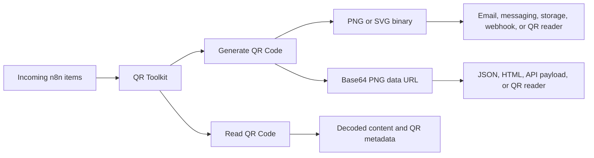

# @cyberace/n8n-nodes-qr

Generate and read QR codes directly inside n8n. QR Toolkit creates PNG, SVG, or Base64 PNG data URL output and reads QR content from PNG binary data or a Base64 PNG data URL, without contacting an external service.

The encoder, decoder, and renderers are implemented in TypeScript and ship with the node. No Python installation, system executable, canvas library, runtime dependency, API key, or external QR service is required.



## Features

- QR Model 2 generation for versions 1-40 with automatic version and mask selection
- UTF-8 byte-mode encoding and L, M, Q, and H error-correction levels
- PNG, SVG, and Base64 PNG data URL output
- Local PNG decoding from n8n binary data or a Base64 data URL
- Numeric, alphanumeric, byte, Latin-1, and UTF-8 ECI payload decoding
- Reading of clean, axis-aligned QR images at 0, 90, 180, or 270 degrees, including inverted colors
- Configurable dimensions, quiet-zone margin, and foreground/background colors
- Native n8n binary data, metadata, item linking, expressions, and Continue On Fail support
- Sequential item processing to keep peak memory use predictable
- Local execution with no network, credential, environment-variable, or file-system access
- No runtime dependencies

## Requirements

- n8n with community nodes enabled
- Node.js 22 or newer when installing the package manually
- For development, see the [supported Node.js versions](CONTRIBUTING.md#development-setup).

Until the package is verified by n8n, use it only on a self-hosted n8n instance that permits unverified community nodes. Installation availability on n8n Cloud depends on n8n verification and is not guaranteed.

## Installation

### Self-hosted n8n user interface

1. Open **Settings > Community Nodes** in n8n.
2. Select **Install**.
3. Enter **@cyberace/n8n-nodes-qr** as the npm package name.
4. Accept the community-node risk notice and complete the installation.
5. Search the node picker for **QR Toolkit**.

Restart n8n if the node does not appear immediately.

### npm installation

```bash
cd ~/.n8n/nodes
npm install @cyberace/n8n-nodes-qr
```

For Docker deployments, make the installation part of the image or use the Community Nodes interface with a persistent n8n data volume. This package is an n8n node plugin; it does not expose a separate JavaScript API.

## Quick start

### Generate

1. Add **QR Toolkit** and select **Generate QR Code**.
2. Set **Content** to text or an expression such as {{ $json.url }}.
3. Choose an output format and execute the workflow.

### Read

1. Add **QR Toolkit** and select **Read QR Code**.
2. Choose **Binary Property** for a PNG received from another node, or **Base64 PNG Data URL** for a value such as {{ $json.dataUrl }}.
3. Execute the workflow and use {{ $json.qrContent }} downstream.

Import [the generation example](examples/generate-qr-code.json) or [the generation-to-decoding round trip](examples/generate-and-read-qr-code.json).

## Generate QR Code fields

| Field                  | Required | Default                    | Description                                                                                      |
| ---------------------- | -------- | -------------------------- | ------------------------------------------------------------------------------------------------ |
| Content                | Yes      | -                          | Text to encode. Expressions resolve independently for each input item.                           |
| Output Format          | Yes      | PNG                        | Returns a PNG binary, SVG binary, or Base64 PNG data URL.                                        |
| Width                  | Yes      | 512                        | Output width and height in pixels, from 64 to 4096.                                              |
| Margin                 | Yes      | 4                          | Quiet-zone width in QR modules, from 0 to 64. Four modules is recommended for reliable scanning. |
| Error Correction Level | Yes      | M                          | L, M, Q, or H. Higher levels recover from more damage but reduce capacity.                       |
| Dark Color             | Yes      | #000000                    | Foreground color in six-digit #RRGGBB format.                                                    |
| Light Color            | Yes      | #FFFFFF                    | Background color in six-digit #RRGGBB format.                                                    |
| Binary Property Name   | PNG/SVG  | data                       | n8n binary property that receives the generated file.                                            |
| File Name              | PNG/SVG  | qr-code.png or qr-code.svg | Safe output name with the selected extension enforced.                                           |

## Read QR Code fields

| Field                | Required | Default             | Description                                                            |
| -------------------- | -------- | ------------------- | ---------------------------------------------------------------------- |
| Input Source         | Yes      | Binary Property     | Reads a PNG from n8n binary data or from a Base64 PNG data URL.        |
| Binary Property Name | Binary   | data                | Binary property containing the PNG image.                              |
| Data URL             | Data URL | {{ $json.dataUrl }} | A data:image/png;base64,... value. Expressions resolve per input item. |

## Output

For generated PNG and SVG files, QR Toolkit preserves incoming JSON and binary properties, writes the generated file to the selected binary property, and adds qrContent, qrFormat, qrWidth, qrFileName, and ISO timestamp qrGeneratedAt.

For generated **Base64 Data URL**, it preserves incoming JSON, adds only dataUrl, and creates no binary property.

Reading preserves incoming JSON and binary properties and adds:

- qrContent
- qrVersion
- qrErrorCorrectionLevel
- qrMask
- qrReadFrom
- qrReadAt as an ISO 8601 timestamp

Every output includes n8n item-linking information so downstream expressions resolve against the correct source item.

## Limits and validation

### Generation

- Content must not be empty and is limited to 10,000 JavaScript characters as a safety boundary.
- Actual QR capacity depends on UTF-8 byte length, error correction, and QR Model 2 version.
- Width must be an integer from 64 through 4096 pixels and provide at least one pixel per rendered module, including the margin.
- Margin must be an integer from 0 through 64 modules.
- Colors must be opaque six-digit hexadecimal values in #RRGGBB format.
- Binary property names must not be empty.
- File names are reduced to a safe base name, limited to 128 characters, and forced to the selected extension.

### Reading

- Input must be a PNG. JPEG, SVG, animated or interlaced PNG, camera perspective, and arbitrary-angle images are not supported.
- PNG input is limited to 16 MiB, and the combined compressed image-data chunks are limited to 8 MiB.
- Dimensions are limited to 4096 by 4096 pixels and 16,777,216 total pixels.
- Supported PNG color types are grayscale, RGB, indexed, grayscale with alpha, and RGBA at supported 1, 2, 4, or 8-bit depths.
- The reader handles clean, axis-aligned QR codes rotated in quarter turns and normal or inverted colors.
- It verifies Reed-Solomon error-correction data but does not repair damaged codewords. Use a clean source image.
- Numeric, alphanumeric, and byte payloads are supported. Kanji mode is not supported.

## Integration examples

The default binary property is data. Change it when a workflow already uses that name.

### Gmail

Generate PNG or SVG output and attach binary data. To read a PNG attachment, download it and pass its binary property to **Read QR Code**.

### Telegram

Generate PNG output and send binary data as a document or photo. For an incoming downloaded PNG, point **Read QR Code** at Telegram's binary output property.

### Google Drive

Upload generated binary data. To decode a stored QR, download the file as binary first, then read that property.

### S3

Upload generated binary data; {{ $json.qrFileName }} can be the object key. To read an existing PNG, download it as binary and pass its property name to the reader.

### Respond to Webhook

Return generated PNG or SVG binary data directly, or a generated Base64 data URL in JSON. After reading a QR, return {{ $json.qrContent }} and the reader metadata as JSON.

## Privacy and security

Generation and reading happen in the n8n Node.js process. QR Toolkit does not make network requests, read credentials or environment variables, access the file system, start commands, or send telemetry. The SVG renderer draws only generated geometry; it never interpolates encoded content into SVG markup.

Input content and images can still be retained in n8n execution data or transmitted by downstream nodes. Apply your normal n8n data-retention, access-control, and workflow-security policies.

## Development

```bash
npm ci
npm run dev
```

Before submitting a change, run:

```bash
npm run format:check
npm run lint
npm run typecheck
npm test
npm run build
npm run verify
npm pack --dry-run
npm audit --audit-level=high
```

See [CONTRIBUTING.md](CONTRIBUTING.md) for contribution requirements.

## Publishing

Releases are published from a vX.Y.Z Git tag by GitHub Actions using npm Trusted Publishing and provenance. No release is performed from a local checkout.

## License

MIT. See [LICENSE.md](LICENSE.md).

Developed by [Enrique Serrano Aparicio](https://enriqueite.com/) and maintained by [CYBERACE](https://cyberace.tech/).

> QR Toolkit is free and open source. If this node saves you time, you can support its development on [Buy Me a Coffee](https://buymeacoffee.com/enriqueite).
